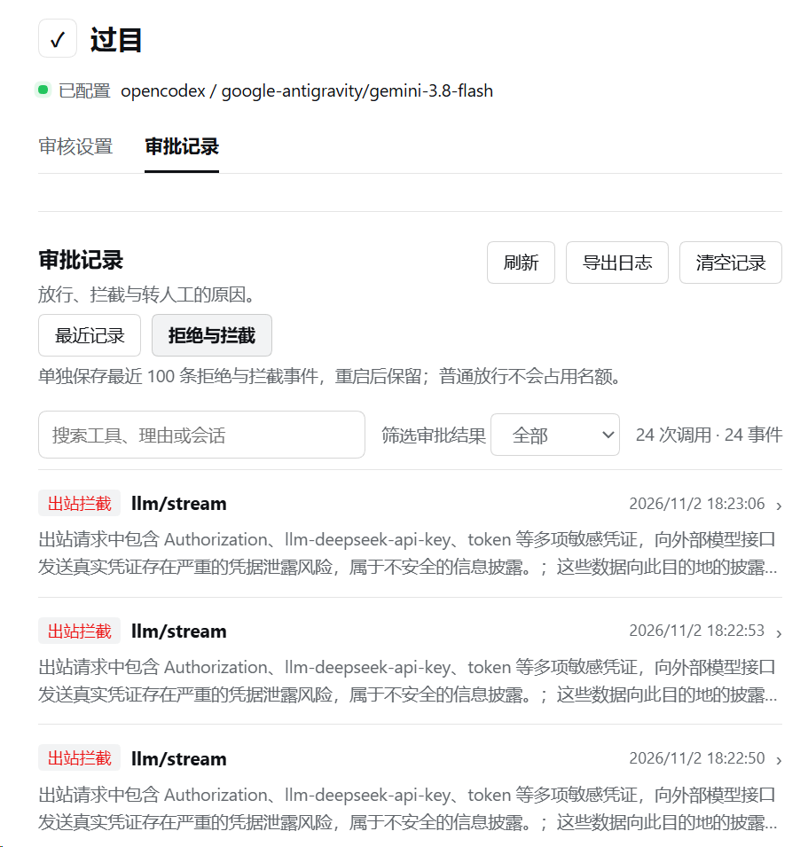

# Second Look · 过目

<p align="center">
  
</p>

<p align="center">
  <a href="README.en.md">English</a> · <a href="README.md">简体中文</a>
</p>

<p align="center">
  <a href="https://github.com/MaRi23333/dsh-second-look/actions/workflows/ci.yml"></a>
  <a href="LICENSE"></a>
  =0.2.1-rc.5 <0.3.0-0" />
</p>

**Usually work in Full access, but want a second opinion before your agent overwrites a file?**

In [DeepSeek Harness](https://github.com/deepseek-ai/deepseek-harness) (DSH), choose **Routine review** from the permissions menu in the message box. Your agent has the same filesystem access as in Full access mode. It can usually read the project docs and create a new guide in the project without stopping for approval. If it tries to overwrite the entire README, a reviewer model you choose checks the action first. The reviewer can allow it, block it, or ask you to decide in DSH.

## Which review plugin fits your workflow?

If you want an AI to review shell commands while you approve file writes yourself, the upstream [dsh-auto-review](https://github.com/PerryLink/dsh-auto-review) plugin lets you set a policy for each tool. Second Look’s presets let you choose by task. Routine review keeps interruptions to a minimum. Actions that pass its rules run without making you click through another prompt or wait for a reviewer. Switch that session to **Enhanced review** when you want a closer look at diffs or scripts. Sessions left in DSH’s built-in Full access mode keep their usual behavior.

**Stepping away from your desk?** Pair Second Look with [ServerChan Watchdog](https://github.com/MaRi23333/dsh-serverchan-watchdog). Once configured, it sends a phone notification when a tool approval has been waiting in DSH longer than your chosen delay (five minutes by default). Return to DSH to approve or decline.

> **Beta 0.1.6** · Requires DSH `>=0.2.1-rc.5 <0.3.0-0` and a reviewer model you trust.

## Download and install

Requires DSH `>=0.2.1-rc.5 <0.3.0-0`. You can install it in the desktop app without opening a terminal.

1. In the sidebar, open **Plugins → Add plugin** and enter `dsh-second-look@latest`. To install this version specifically, enter `dsh-second-look@0.1.6`.
2. Select **Enable now** after installation. If a restart is requested, choose **Quit** from the application menu and reopen DSH.
3. Look for **Settings → Second Look** to confirm it is enabled.

**Prefer a download?** [Download dsh-second-look-0.1.6.tgz](https://github.com/MaRi23333/dsh-second-look/releases/download/v0.1.6/dsh-second-look-0.1.6.tgz). Leave it packed and enter its full path in the same **Add plugin** box, then enable it as above. [View on npm](https://www.npmjs.com/package/dsh-second-look)

<details>
<summary>Install with the desktop CLI</summary>

Start DSH Desktop once, select **Manage dsh Command… → Install** from the application menu, then quit the app. In a new terminal, run:

```sh
dsh plugin --profile desktop add dsh-second-look@0.1.6
dsh plugin --profile desktop list
```

Once you see `dsh-second-look@0.1.6`, reopen Desktop and enable the plugin. Use the `dsh` command bundled with Desktop; a standalone CLI installed with npm or run with `npx` cannot manage desktop plugins.

</details>

## Why was a request blocked?

<p align="center">
  
</p>
<p align="center"><em>Open Denials and blocks to see why each of these requests was stopped before it was sent.</em></p>

Search events, filter by outcome, refresh, export redacted JSON, or clear the current category. Recent activity keeps the latest 500 events for the current process. Denials and blocks separately retains the latest 100 event summaries across restarts; routine approvals do not use those slots.

## Choose the review depth for the task

Open the permissions menu in the message box and choose Routine or Enhanced review for this session.

| Tier | Best suited to | How it reviews |
| --- | --- | --- |
| **Routine review** | Everyday development and tool use | Routine reads and ordinary new-file writes pass by rule. Whole-file overwrites of existing non-empty files are reviewed; risky actions go to the independent model, which can make one more round of read-only checks. |
| **Enhanced review** | Tasks needing closer inspection of code changes, scripts, or outbound actions | Adds inspection of diffs and scripts, up to three rounds of read-only checks, and a tool the agent can use to see which files have been reviewed before it finishes. |

Routine review passes main model requests through as written. Enhanced review checks them for sensitive content and uses a redacted copy when possible. Both tiers redact matched evidence before sending it to the independent reviewer. When you switch from Enhanced to Routine, the composer warns that future requests may send sensitive content from the conversation history as written.

You choose the reviewer model, and Enhanced review can use a separate one. Subagents use the review settings of their parent session. The interface and prompts follow the host's English or Simplified Chinese language setting.

## Try it

1. **Choose a reviewer:** open **Settings → Second Look → Review settings** and select a provider and model. Tool arguments, relevant context, and parts of code diffs may be sent to that model for review. The plugin cannot redact all sensitive content.
2. **Select a tier:** choose **Routine review** or **Enhanced review** from the composer permission menu. Ask the AI to read a file, then look for the result in Approval history.

## Before you start

- **The reviewer can miss things.** It may allow a risky action or block a harmless one. Calling the reviewer also takes time and uses extra tokens.
- **Only some actions are checked.** In sessions with review enabled, Second Look checks tool calls that go through DSH approval. It cannot stop another plugin from accessing files or the network directly. It does not replace an OS sandbox.
- **Enhanced review can block a model request.** If a request contains matched sensitive content and disclosure is unauthorized, Second Look tries to redact it and checks the copy before sending. It returns a block error if it cannot safely send a copy. DSH approval dialogs are for tool calls.
- **The AI can reply before every file has been reviewed.** In Enhanced review, the agent has to run the final file check itself. You can ask it to list any files still awaiting review before it finishes.

See the [usage and technical guide](https://github.com/MaRi23333/dsh-second-look/blob/main/docs/TECHNICAL.en.md) for configuration, retention, and the full security boundaries.

## Origins and license

Second Look is adapted from [dsh-auto-review](https://github.com/PerryLink/dsh-auto-review), with code from dsh-heavy-approval and DSH's permission selector. The project uses **Apache-2.0**; included third-party MIT notices and source details are in [LICENSE](LICENSE) and [THIRD-PARTY-SOURCES.md](THIRD-PARTY-SOURCES.md).
