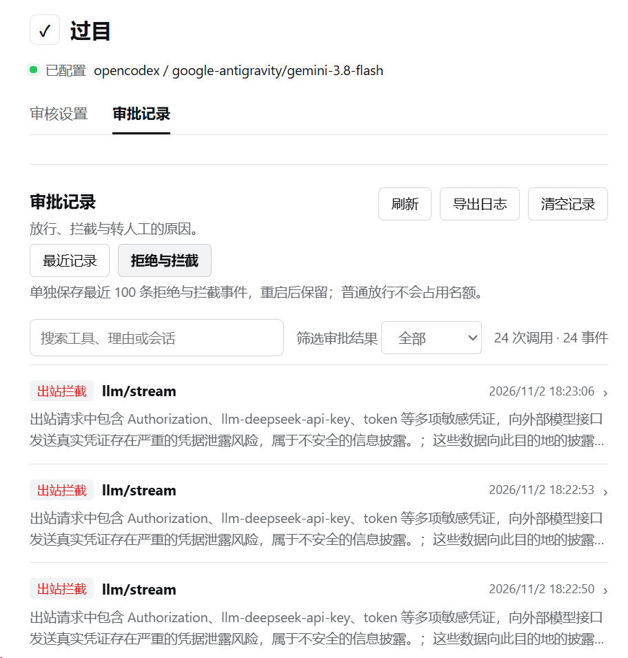

# Second Look · 过目

  

  <a href="README.en.md">English</a> · <a href="README.md">简体中文</a>

  
  
  =0.2.1-rc.5 <0.3.0-0" />

**Have a second model check before your AI overwrites a file or runs a suspicious command.**

Second Look is a tool-action review plugin for [DeepSeek Harness](https://github.com/deepseek-ai/deepseek-harness) (DSH). In sessions with review enabled, routine low-risk actions pass by rule. Actions such as high-risk deletion, whole-file overwrites, and suspicious commands go to a reviewer model you choose. Tool actions that need your decision return to DSH's human approval interface.

Choose the review depth for each task, then look back at why an action was allowed, blocked, or referred to you.

> **Beta 0.1.3** · Requires DSH `>=0.2.1-rc.5 <0.3.0-0` and a reviewer model you trust.

## When is it useful?

- **When your AI edits files or runs commands:** add an independent check to automated work, with attention to high-risk deletion, overwrites, scripts, and outbound actions.
- **When a task needs closer inspection:** use Enhanced review to examine diffs and scripts, reading related files if it needs more information.
- **When you want to understand a block:** find the relevant history by tool, reason, or session and read why the decision was made.

## Why was a request blocked?

  

<em>Open Denials and blocks to see why each of these requests was stopped before it was sent.</em>

Search events, filter by outcome, refresh, export redacted JSON, or clear the current category. Recent activity keeps the latest 500 events for the current process. Denials and blocks separately retains the latest 100 event summaries across restarts; routine approvals do not use those slots.

## Choose the review depth for the task

Open the permissions menu in the message box and choose Routine or Enhanced review for this session.

| Tier | Best suited to | How it reviews |
| --- | --- | --- |
| **Routine review** | Everyday development and tool use | Routine reads and ordinary new-file writes pass by rule. Whole-file overwrites of existing non-empty files are reviewed; risky actions go to the independent model, which can make one more round of read-only checks. |
| **Enhanced review** | Tasks needing closer inspection of code changes, scripts, or outbound actions | Adds inspection of diffs and scripts, up to three rounds of read-only checks, and a tool the agent can use to see which files have been reviewed before it finishes. |

You choose the reviewer model, and Enhanced review can use a separate one. Subagents use the review settings of their parent session. The interface and prompts follow the host's English or Simplified Chinese language setting.

## Try it

1. **Install the plugin:** in DSH Desktop, open **Plugins → Add plugin** and enter `dsh-second-look@0.1.3`. Select **Enable now** after installation. If prompted, quit and reopen DSH. Alternatively, download the `.tgz` from the [GitHub release](https://github.com/MaRi23333/dsh-second-look/releases/tag/v0.1.3) and enter its full path without extracting it.
2. **Choose a reviewer:** open **Settings → Second Look → Review settings** and select a provider and model. Tool arguments, relevant context, and parts of code diffs may be sent to that model for review. The plugin cannot redact all sensitive content.
3. **Select a tier:** choose **Routine review** or **Enhanced review** from the composer permission menu. Ask the AI to read a file, then look for the result in Approval history.

## Before you start

- **The reviewer can miss things.** It may allow a risky action or block a harmless one. Calling the reviewer also takes time and uses extra tokens.
- **Only some actions are checked.** In sessions with review enabled, Second Look checks tool calls that go through DSH approval. It cannot stop another plugin from accessing files or the network directly. It does not replace an OS sandbox.
- **Some requests stop without a prompt.** DSH can ask you to approve a tool call. If a request to a model contains sensitive information you haven’t approved for sharing, Second Look tries to redact it. It sends the copy only if it passes a second check; otherwise it blocks the request without asking you.
- **The AI can reply before every file has been reviewed.** In Enhanced review, the agent has to run the final file check itself. You can ask it to list any files still awaiting review before it finishes.

See the [usage and technical guide](https://github.com/MaRi23333/dsh-second-look/blob/main/docs/TECHNICAL.en.md) for configuration, retention, and the full security boundaries.

## Origins and license

Second Look is adapted from [dsh-auto-review](https://github.com/PerryLink/dsh-auto-review), with code from dsh-heavy-approval and DSH's permission selector. The project uses **Apache-2.0**; included third-party MIT notices and source details are in [LICENSE](LICENSE) and [THIRD-PARTY-SOURCES.md](THIRD-PARTY-SOURCES.md).
