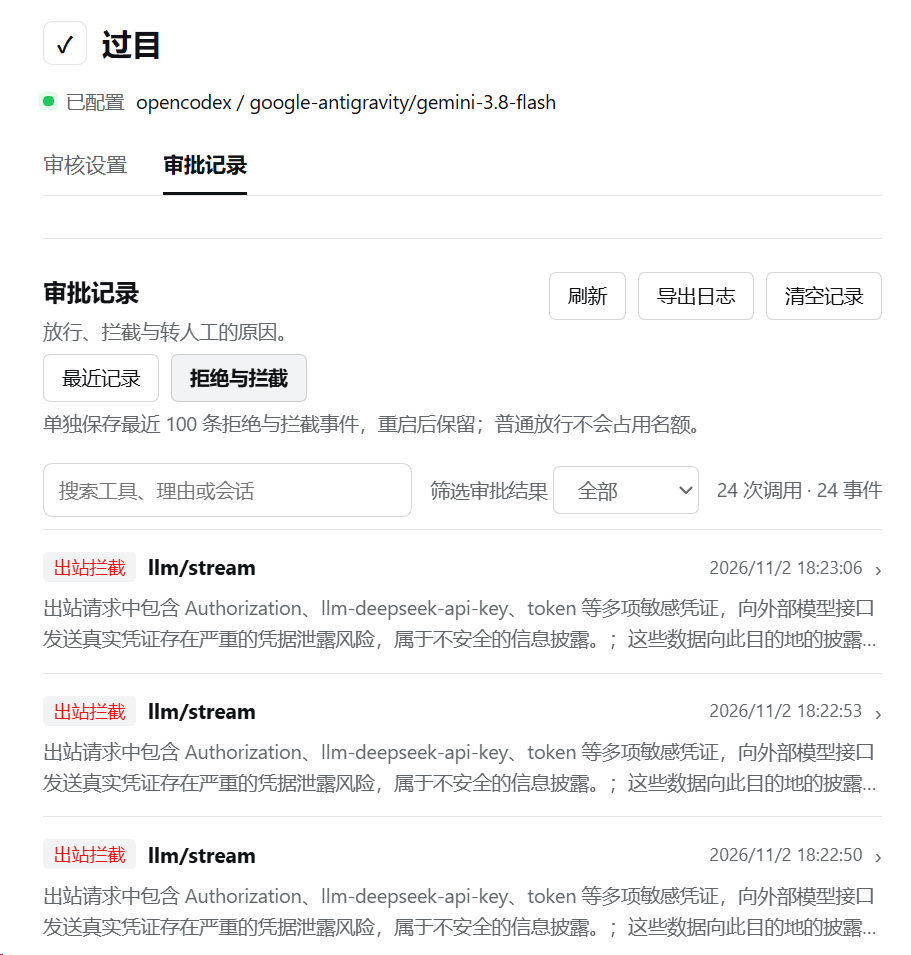

# 过目 · Second Look

  

  <a href="README.md">简体中文</a> · <a href="README.en.md">English</a>

  
  
  =0.2.1-rc.5 <0.3.0-0" />

**AI 要覆盖文件或运行可疑命令时，可以先让另一个模型检查。**

过目是 [DeepSeek Harness](https://github.com/deepseek-ai/deepseek-harness)（DSH）的工具操作审核插件。在启用审查的会话里，常规低风险操作按规则放行，涉及高风险删除、整文件覆盖、可疑命令等操作时，再交给你指定的审核模型判断。需要人工决定的工具操作，会转回 DSH 的审批界面。

你可以按任务选择审查力度，也可以回看一次操作为什么被放行、拦截或转交人工。

> **测试版 0.1.3** · 需要 DSH `>=0.2.1-rc.5 <0.3.0-0` 和一个你信任的审核模型。

## 适合什么时候用？

- **让 AI 改文件、跑命令时**：在自动执行过程中增加独立判断，尤其关注高风险删除、覆盖、脚本与外传行为。
- **任务复杂、想多看一层时**：切换到加强审查，让审核模型进一步查看差异与脚本内容，信息不足时，它可以再读取相关文件，不会修改文件。
- **想弄清一次拦截时**：按工具、理由或会话找到相关记录，回看当时的判断依据。

## 为什么被拦截了？

  

<em>这几条请求为什么没发出去？在「拒绝与拦截」里可以看到原因。</em>

审批记录支持搜索、按审批结果筛选、手动刷新、导出脱敏 JSON 和清空当前分类记录。「最近记录」保留本次运行最近 500 条事件；「拒绝与拦截」单独保留最近 100 条事件摘要，重启后仍可查看，普通放行不计入这 100 条。

## 按任务选择审查力度

每个会话可以单独设置。在输入栏打开权限菜单，选「日常审查」或「加强审查」。

| 档位 | 适合的任务 | 如何审查 |
| --- | --- | --- |
| **日常审查** | 常规开发与工具操作 | 常规只读、新建普通文件等操作按规则放行；已有非空文件的整文件覆盖送审，遇到风险操作，审核模型最多可以再读取 1 轮相关信息。 |
| **加强审查** | 希望进一步检查代码改动、脚本或外传行为的任务 | 在日常规则基础上检查差异、脚本等内容，审核模型最多可以再读取 3 轮相关信息。任务结束前，AI 还可以核对哪些文件已经审过。 |

审核模型由你选择，加强档也可以单独配置。启用审查后，子代理会沿用父会话的审查设置；界面和提示跟随宿主的中文或英文设置。

## 开始试用

1. **安装插件**：在 DSH 桌面版打开「插件 → 添加插件」，输入 `dsh-second-look@0.1.3`。安装后点击「立即启用」；若提示重启，退出并重新打开 DSH。也可从 [GitHub Release](https://github.com/MaRi23333/dsh-second-look/releases/tag/v0.1.3) 下载 `.tgz`，不解压，在同一处输入文件的完整路径。
2. **选择审核模型**：在「设置 → 过目 → 审核设置」选择服务商和模型。送审时，工具参数、相关上下文和部分代码差异可能发给这个模型。插件无法脱敏所有敏感内容。
3. **为会话选档**：在输入栏权限菜单选择「日常审查」或「加强审查」，让 AI 读取一个文件，再打开「审批记录」查看结果。

## 用前须知

- **仍有可能疏漏。** 审核模型可能放过危险操作，也可能拦下正常操作。调用审核模型需要等待，也会消耗额外的 Token。
- **过目只检查部分操作。** 它只能检查已开启审查的会话中交给 DSH 审批的工具操作。其他插件自己读写文件或直接联网时，过目管不到。它不能替代操作系统沙箱。
- **有些请求不会弹窗。** 工具操作可以交给你决定。发给模型的请求如果含有未经授权发送的敏感内容，过目会尝试脱敏；复查通过才发送，否则直接拦截，不会弹窗让你放行。
- **AI 可能没审完就回复。** 在加强档，AI 需要主动调用工具核对改过的文件。想知道还有哪些没审，可以让它在结束前列出来。

更完整的使用方法、配置、保留策略与安全边界见[使用与技术说明](https://github.com/MaRi23333/dsh-second-look/blob/main/docs/TECHNICAL.zh-CN.md)。

## 来源与许可

过目基于 [dsh-auto-review](https://github.com/PerryLink/dsh-auto-review) 改编，并使用了 dsh-heavy-approval 与 DSH 权限选择组件的部分代码。项目采用 **Apache-2.0**，所含第三方 MIT 声明与具体来源见 [LICENSE](LICENSE) 和 [THIRD-PARTY-SOURCES.md](THIRD-PARTY-SOURCES.md)。
