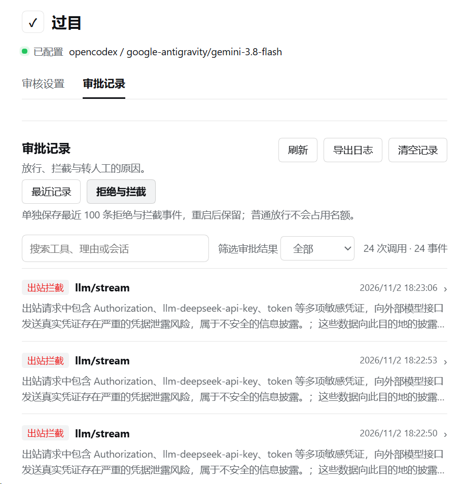

# 过目 · Second Look

<p align="center">
  
</p>

<p align="center">
  <a href="README.md">简体中文</a> · <a href="README.en.md">English</a>
</p>

<p align="center">
  <a href="https://github.com/MaRi23333/dsh-second-look/actions/workflows/ci.yml"></a>
  <a href="LICENSE"></a>
  =0.2.1-rc.5 <0.3.0-0" />
</p>

**习惯开「完全权限」，也希望 AI 覆盖文件前能多一道检查？**

在 [DeepSeek Harness](https://github.com/deepseek-ai/deepseek-harness)（DSH）的输入栏里，把当前会话切到 **日常审查**。这个档位沿用「完全权限」的访问范围。让 AI 读项目文档、在项目里新建一份指南，这些常规操作通常可以直接继续。要是它准备把原有的 README 整个覆盖掉，过目会先请你选的审核模型看一眼。模型可以放行、拦截，或交给你在 DSH 里决定。

## 和其他审核插件怎么选？

如果你想自己定规则，比如把命令执行交给 AI 审、把文件写入留给自己，上游 [dsh-auto-review](https://github.com/PerryLink/dsh-auto-review) 可以按工具分配审批。过目的默认用法是按任务选档。「日常审查」主打低打扰。能按规则放行的操作会直接执行，不用你反复点确认，也不用等审核模型。遇到需要仔细核对代码差异或脚本的任务，再把这个会话切到 **加强审查**。保留 DSH 原生「完全权限」的会话仍按原来的方式运行。

**离开电脑时也能收到提醒。** 可以搭配 [Server酱推送小助手](https://github.com/MaRi23333/dsh-serverchan-watchdog)。安装并配置好后，如果 DSH 等你批准一项操作超过设定时间（默认 5 分钟），小助手会推送到手机。回到 DSH 就能处理这次审批。

> **测试版 0.1.5** · 需要 DSH `>=0.2.1-rc.5 <0.3.0-0` 和一个你信任的审核模型。

## 下载安装

需要 DSH `>=0.2.1-rc.5 <0.3.0-0`。桌面版直接在插件页安装，无需打开终端。

1. 在左侧栏打开 **插件 → 添加插件**，输入 `dsh-second-look@latest`。要安装本版，输入 `dsh-second-look@0.1.5`。
2. 安装完成后点 **立即启用**。如果提示重启，从应用菜单选 **退出（Quit）**，再重新打开 DSH。
3. 在 **设置 → 过目** 看到插件入口，即已启用。

**手动下载安装包：** [下载 dsh-second-look-0.1.5.tgz](https://github.com/MaRi23333/dsh-second-look/releases/download/v0.1.5/dsh-second-look-0.1.5.tgz)，不用解压。在同一个「添加插件」框里输入下载文件的完整路径，再按上面的步骤启用。[查看 npm 包](https://www.npmjs.com/package/dsh-second-look)

<details>
<summary>用桌面版命令行安装</summary>

先启动一次 DSH Desktop，在应用菜单选 **Manage dsh Command… → Install**，然后退出桌面版。打开新终端，运行：

```sh
dsh plugin --profile desktop add dsh-second-look@0.1.5
dsh plugin --profile desktop list
```

看到 `dsh-second-look@0.1.5` 后，重新打开桌面版并启用插件。请使用桌面版自带的 `dsh` 命令；通过 npm 或 `npx` 启动的独立 CLI 不能管理桌面插件。

</details>

## 为什么被拦截了？

<p align="center">
  
</p>
<p align="center"><em>这几条请求为什么没发出去？在「拒绝与拦截」里可以看到原因。</em></p>

审批记录支持搜索、按审批结果筛选、手动刷新、导出脱敏 JSON 和清空当前分类记录。「最近记录」保留本次运行最近 500 条事件；「拒绝与拦截」单独保留最近 100 条事件摘要，重启后仍可查看，普通放行不计入这 100 条。

## 按任务选择审查力度

每个会话可以单独设置。在输入栏打开权限菜单，选「日常审查」或「加强审查」。

| 档位 | 适合的任务 | 如何审查 |
| --- | --- | --- |
| **日常审查** | 常规开发与工具操作 | 常规只读、新建普通文件等操作按规则放行；已有非空文件的整文件覆盖送审，遇到风险操作，审核模型最多可以再读取 1 轮相关信息。 |
| **加强审查** | 希望进一步检查代码改动、脚本或外传行为的任务 | 在日常规则基础上检查差异、脚本等内容，审核模型最多可以再读取 3 轮相关信息。任务结束前，AI 还可以核对哪些文件已经审过。 |

日常审查把主模型请求原样发送。加强审查会检查主模型请求中的敏感内容，并在可行时脱敏后继续。两档发给独立审核模型的证据都按规则脱敏。从加强切回日常时，输入栏会提示历史中的敏感原文可能在后续请求中发给主模型。

审核模型由你选择，加强档也可以单独配置。启用审查后，子代理会沿用父会话的审查设置；界面和提示跟随宿主的中文或英文设置。

## 开始试用

1. **选择审核模型**：在「设置 → 过目 → 审核设置」选择服务商和模型。送审时，工具参数、相关上下文和部分代码差异可能发给这个模型。插件无法脱敏所有敏感内容。
2. **为会话选档**：在输入栏权限菜单选择「日常审查」或「加强审查」，让 AI 读取一个文件，再打开「审批记录」查看结果。

## 用前须知

- **仍有可能疏漏。** 审核模型可能放过危险操作，也可能拦下正常操作。调用审核模型需要等待，也会消耗额外的 Token。
- **过目只检查部分操作。** 它只能检查已开启审查的会话中交给 DSH 审批的工具操作。其他插件自己读写文件或直接联网时，过目管不到。它不能替代操作系统沙箱。
- **加强审查可能拦截模型请求。** 命中未经授权的敏感内容时，过目会尝试脱敏并复查。复查通过就用脱敏副本继续，否则返回拦截错误。人工确认弹窗用于工具审批。
- **AI 可能没审完就回复。** 在加强档，AI 需要主动调用工具核对改过的文件。想知道还有哪些没审，可以让它在结束前列出来。

更完整的使用方法、配置、保留策略与安全边界见[使用与技术说明](https://github.com/MaRi23333/dsh-second-look/blob/main/docs/TECHNICAL.zh-CN.md)。

## 来源与许可

过目基于 [dsh-auto-review](https://github.com/PerryLink/dsh-auto-review) 改编，并使用了 dsh-heavy-approval 与 DSH 权限选择组件的部分代码。项目采用 **Apache-2.0**，所含第三方 MIT 声明与具体来源见 [LICENSE](LICENSE) 和 [THIRD-PARTY-SOURCES.md](THIRD-PARTY-SOURCES.md)。
